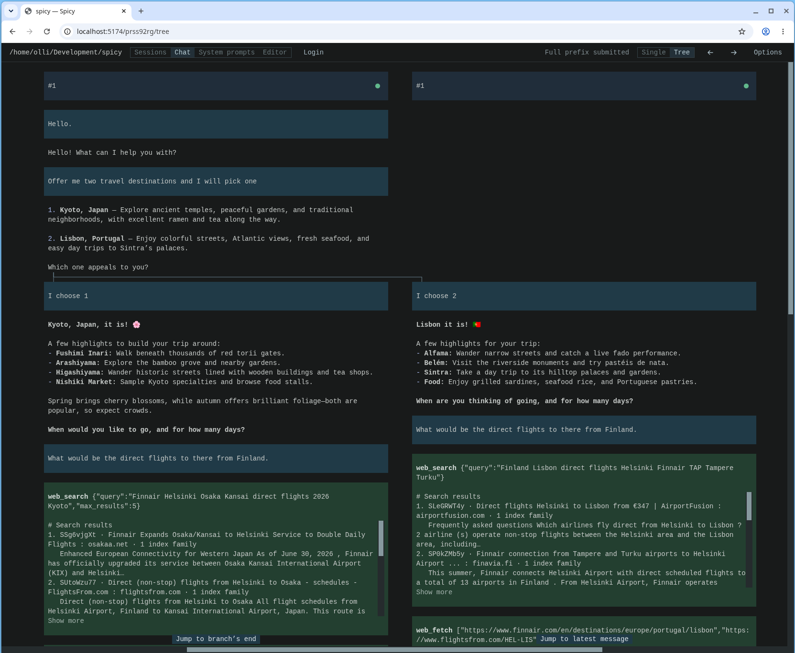
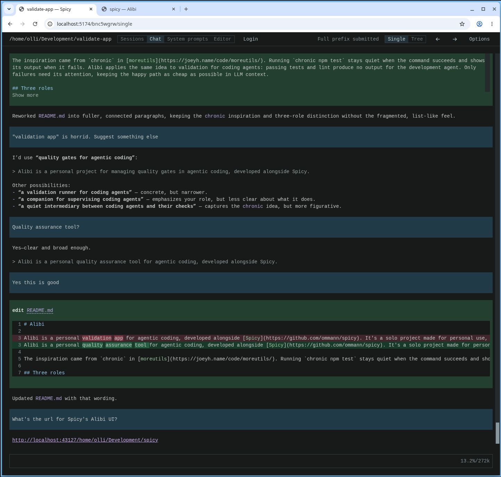

# Spicy

Spicy is a personal LLM harness forked from [Pi](https://github.com/earendil-works/pi), originally turned into a client-server web app.

- Solo project made for personal use.
- Intentionally unpackaged.
- Values direct source code manipulation over extensibility.
- Explores agentic coding through bootstrapping: using Spicy to develop Spicy.
- Conceptually a text-based UI, but not constrained by terminal conventions.

## Direction

- First and foremost, a harness that enables human supervision.
- Access to the usual tools, but also reading and editing system prompts and the compaction process.
- Proper Linux isolation.
- Easily parseable chat history.
- Non-LLM compaction.
- Tree-like conversation prefixes allow exploration in any direction, including both “yes” and “no” branches of any particular crossroad.
- Not made for running subagents yet.

## Disclaimer

- Spicy is at a very early stage.
- Development aims to make maximal use of agentic coding.
- Provider authentication is inherited from Pi and has not been verified in Spicy.

## Running

Requires Node.js 22.19.0 or newer.

```sh
npm install
npm start
```

Open http://localhost:5174.

## Screenshots




